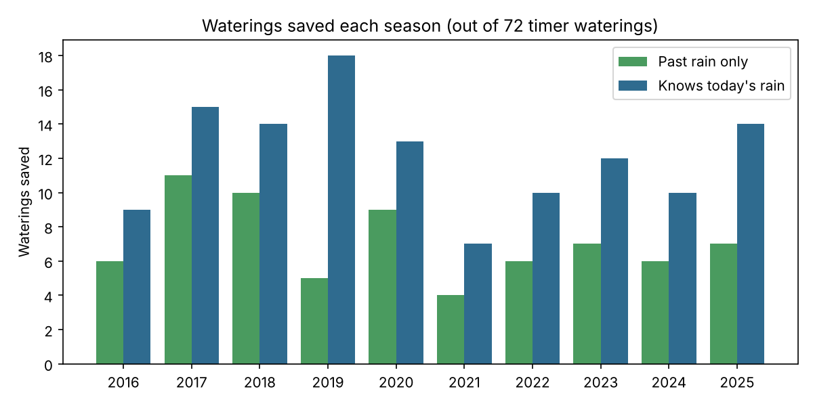
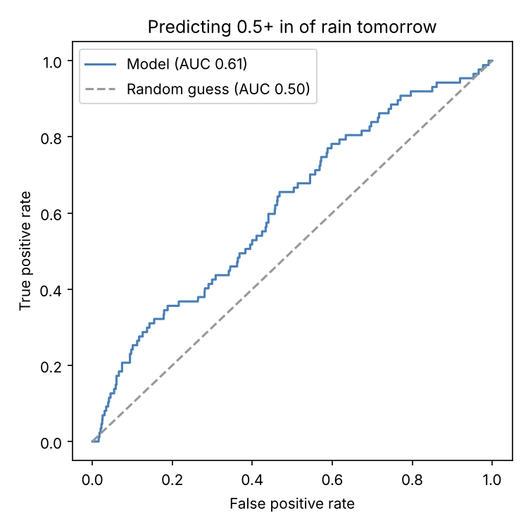

# charlotte-rain-skip

How often does a sprinkler timer in Charlotte, NC water right after it already rained? And how much would a simple rain-aware schedule actually save? I used 10 years of NOAA weather data (2016 to 2025) to find out.

I made this as a starting point for a bigger project I have in mind: an irrigation controller that decides when to water using weather and soil data. I wanted some experience with this kind of weather data first.

I used an AI assistant to help write and review the code.

## Results

A timer that waters every 3 days from April to October would water 720 times over the 10 seasons. 111 of those waterings (15.4%) came right after a day with at least half an inch of rain.


I tested two rain-aware rules. Both water when it's been at least 3 days since the last watering, but skip a day if either of the 2 days before had at least half an inch of rain.

- Past rain only: 649 waterings, saving 71 (9.9%)
- Also knows today's rain, like a controller with a rain sensor: 598 waterings, saving 122 (16.9%)



The past-rain rule saves only about 10%, even though about 15% of timer waterings came right after rain. My first explanation was that skipped waterings just got pushed back a day or two, but that was wrong. The real reason is that the rule can't see rain that hasn't fallen yet. 51 of its 649 waterings land on days that get half an inch or more of rain. Once the rule also knows today's rain, it saves 16.9%, which is more than the 15.4%. So my irrigation controller needs to know about today's rain, not just yesterday's.

## How it works

prepare_data.py takes NOAA's daily file for Charlotte Douglas Airport, keeps 2016 to 2025 and converts the units. The data folder has its own README with the source and columns.

rain_skip.py simulates the timer and both rules. The timer waters every third day from April 1 to October 31. All three use the same check for "right after rain": either of the 2 days before had 0.5 inches or more. The rules wait at least 3 days between waterings and skip any day that passes that check. The second rule also skips days that get 0.5 inches or more themselves. The settings are at the top of the file if you want to try different numbers.

charts.py makes the two charts above.

test_rules.py checks the timer, both rules and the model's waiting logic on 10 made-up days where I worked out the answers by hand. There's also a check that rain at the end of March still counts for April 1. GitHub runs these tests on every push.

rain_model.py trains the rain model described below, cross-validates it, tests it and draws its ROC curve.

## Running it

```
pip install -r requirements.txt
python rain_skip.py
python charts.py
python rain_model.py
pytest
```

## Can a model look ahead?

I also trained a model to guess whether tomorrow will get at least half an inch of rain, using today's weather: rain, temperature, humidity, pressure, wind, dew point and the month. It's a gradient-boosted decision tree model from scikit-learn. I checked it two ways: 5-fold cross-validation on 2016 to 2022, with folds in time order so the model never trains on the future, and a final test on 2023 to 2025.

It didn't work well. Its AUC was 0.63 in cross-validation and 0.61 on the test years, where 0.5 is random guessing and 1.0 is perfect. That's a little better than chance, but not by much.



Accuracy makes it look better than it is. Big rain followed only 7.9% of days, so guessing "no big rain" every day is right 92.1% of the time. A random 50/50 guess is right 50% of the time, and a random guess at the real rate is right 85.4%. The model was right 92.1% of the time at a 50% cutoff, which only ties with always guessing no.

Using it to delay watering didn't help much either. I added it to the rule that knows today's rain: on a day the rule would water, if the model's chance of big rain tomorrow is high enough, it waits one day. If the rain comes, that watering is skipped. On its own, that rule waters 180 times in 2023 to 2025.

- 30% cutoff: it waited once, rain didn't come, and nothing was saved
- 20% cutoff: it waited 9 times and rain came 3 times. It watered 4 fewer times, but the garden also went 6 extra days without water
- 10% cutoff: it waited 56 times and rain came only 7 times. It watered 18 fewer times, but most of that came from the garden going 49 extra days without water

Only the waits where rain really came count as savings. At best that's 7 waterings over three seasons, and it cost 49 dry days to get there.

I also tried more features, smaller trees, balancing the classes and a logistic regression. None of them got past an AUC of about 0.63 in cross-validation. So my models couldn't predict tomorrow's rain well from one station's daily numbers. For the irrigation controller, a real weather forecast will probably work better than a model trained only on this data.

## Limits

The weather data comes from one station at the airport, so it won't match every yard in Charlotte. The simulation only looks at rain. It ignores soil type, heat, sun and what's planted, and it assumes half an inch of rain is enough to skip a watering. The data only has daily totals, so the rule that knows today's rain assumes the controller waters late in the day, after the rain has fallen.

## What I learned

This was my first time building a simulation. I also learned how to use shift() and groupby() in pandas, and that a model has to beat a simple guess before it's worth using. The first version of my rule watered on stormy days because it decided to water before looking at that day's rain, so now I check the order of steps and test them on small examples with known answers.

## Next steps

- Running the same check for nearby cities
- Testing a real weather forecast instead of my own rain model
- Using this as a starting point for my irrigation controller

## License

MIT
