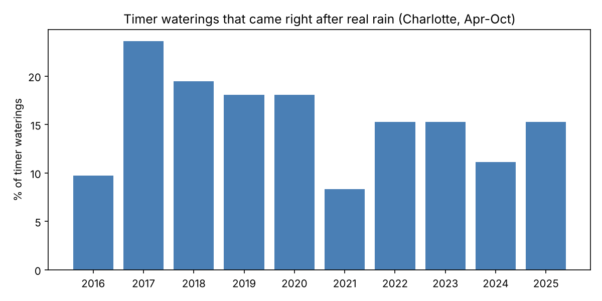

# charlotte-rain-skip

How often does a sprinkler timer in Charlotte, NC water right after it already rained? And how much would a simple rain-aware schedule actually save? I used 10 years of NOAA weather data (2016 to 2025) to find out.

I made this as a starting point for a bigger project I have in mind: an irrigation controller that decides when to water using weather and soil data. I wanted some experience with this kind of weather data first.

## Results

A timer that waters every 3 days from April to October would water 720 times over the 10 seasons. 111 of those waterings (15.4%) came right after a day with at least half an inch of rain.



A rule that only waters when it's been 3 days since the garden last got water, from the sprinkler or from real rain, would water 651 times. That saves 69 waterings, or 9.6%.


The part that surprised me most is that gap. About 15% of timer waterings happen right after rain, but skipping them only saves about 10%. A skipped watering doesn't always disappear. Often it just gets pushed back a day or two.

## How it works

prepare_data.py takes NOAA's daily file for Charlotte Douglas Airport, keeps 2016 to 2025 and converts the units. The data folder has its own README with the source and columns.

rain_skip.py simulates both schedules. The timer waters every third day from April 1 to October 31. A watering counts as "right after rain" if either of the 2 days before it had 0.5 inches or more. The rain-aware rule keeps a count of days since the garden last got water and resets it after a watering or a day with 0.5 inches of rain. The settings are at the top of the file if you want to try different numbers.

charts.py makes the two charts above.

## Running it

```
pip install pandas matplotlib
python rain_skip.py
python charts.py
```

## Limits

The weather data comes from one station at the airport, so it won't match every yard in Charlotte. The simulation only looks at rain. It ignores soil type, heat, sun and what's planted, and it assumes half an inch of rain is enough to skip a watering.

## What I learned

This was my first time building a simulation. I also learned how to use shift() and groupby() in pandas.

## Next steps

- A machine learning model that predicts tomorrow's rain, to see if looking ahead saves more water than looking back
- Running the same check for nearby cities
- Using this as a starting point for my irrigation controller

## License

MIT
